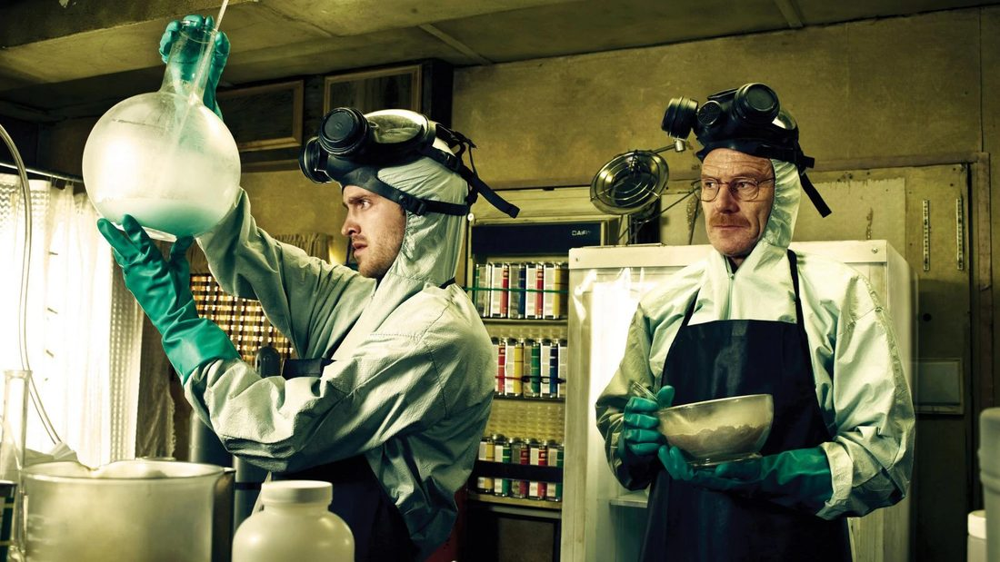

::: module-meta
<span>⏱ ~25 minutes</span><span>Track: everyone [BA]{.ba-tag}</span><span>Checkpoint: [Module 4 quiz]()</span>
:::

{.module-hero fig-alt="Two people in protective suits and gas masks working in a makeshift laboratory"}

## Why this matters

A study is a long chain of steps, and every step leaves documents behind. If those documents are complete and in the right place, anyone can pick up the project, reviewers can check our work, and we can reuse the materials years later.

## Stages of research

```{=html}
<div class="stages" role="list" aria-label="Stages of a research project">
  <section class="stage-phase" role="listitem">
    <h4><span class="stage-num">1</span> Plan</h4>
    <ol>
      <li>An idea worth pursuing</li>
      <li>Collect previous results and knowledge</li>
      <li>Set up the project in ClickUp</li>
      <li>Write and iterate the research plan</li>
    </ol>
  </section>
  <section class="stage-phase" role="listitem">
    <h4><span class="stage-num">2</span> Prepare</h4>
    <ol start="5">
      <li>Create materials (stimuli, questionnaires, scripts) and run pilots</li>
      <li>Acquire equipment, licences, incentives</li>
      <li>Ethics application <em>(lab head submits)</em></li>
      <li>Pre-registration on OSF Registries</li>
    </ol>
  </section>
  <section class="stage-phase" role="listitem">
    <h4><span class="stage-num">3</span> Collect &amp; analyze</h4>
    <ol start="9">
      <li>Collect data</li>
      <li>Preprocess data</li>
      <li>Analyze data</li>
    </ol>
  </section>
  <section class="stage-phase" role="listitem">
    <h4><span class="stage-num">4</span> Share</h4>
    <ol start="12">
      <li>Write the manuscript and other communications</li>
      <li>Submit, and upload a preprint</li>
      <li>Publish the article, plus data, code and materials</li>
      <li>Close and archive the project</li>
    </ol>
  </section>
</div>
```

## Study documents

Every study has:

- **Meeting notes** for its meetings.
- A **Google Drive folder** with all files important for the project, owned by the lab account (module 3).
- A **GitHub repository** for the analysis code if it is written in R.
- The **ethics application and permission** documents.
- A **pre-registration** on [OSF Registries](https://osf.io/registries), for every study that involves data collection. Start from the lab's [OSF Prereg template]().

In-person lab studies also need:

- A **research protocol** that describes the procedure in every detail.
- A **lab log** that records every session and every event.

::: callout-tip
## Let an AI agent do the first draft
Templates are much faster with an AI agent: give it the research plan and ask it to prefill the pre-registration template, then go through every section yourself. See module 2 for the rules.
:::

## Transparency

We make every study as transparent as possible: we pre-register, make data, analysis code and materials public, and publish in open access journals. Data, code and materials are published in a public repository for every project, except when the data was collected by someone else. We are moving away from OSF projects for this, most likely to [Zenodo](https://zenodo.org/); your supervisor will tell you where your project's materials go.

## Data collection [BA]{.ba-tag}

- Data collection only happens with supervision, and only with ethics permission.
- Lab sessions are booked through [youcanbook.me](https://youcanbook.me/).
- Online questionnaires usually run on [Qualtrics](https://www.qualtrics.com/) or [Google Forms](https://www.google.com/forms).
- Experiments run on whichever platform suits the project, such as lab.js, PsyToolkit or OpenSesame.
- Participants create their own ID code with the lab's [Participant ID template](): "SE" followed by 8 digits, for example `SE05685678`. The template includes the instructions in English and Hungarian, and a validation rule (`^SE\d{8}$`) to paste into the survey.
- Some online experiments and media files run on the lab's own cloud server. Your project supervisor will give you access and instructions if your project uses it.

## Interacting with participants [BA]{.ba-tag}

- Always follow the instructions of the project supervisor and the research protocol.
- Always respect participants. Without them, we would have no data.
- Record **every irregular event** in the project's lab log.

## Lab rooms, devices and materials [BA]{.ba-tag}

- The lab is room 521 in the Izabella utca building. Lab sessions usually run in rooms 402 and 422 on the 4th floor; your supervisor will tell you which one your study uses.
- To pick up the key card and keys for the lab rooms from the reception on your own, you need a signed authorization. Fill in your name in the [authorization template]() and ask the lab leader to sign it.
- Handle lab equipment, especially electronic devices, with care and leave it in good condition.
- In case of malfunction or an accident, report it to the project supervisor and the lab leader **immediately**.
- Always clean equipment that a participant used, for example earphones.
- Always tidy up the lab before leaving.

## Do

These tasks are also in your ClickUp onboarding task.

- [ ] Ask your supervisor for a published lab study and its pre-registration. Compare the planned hypotheses and analyses with what the paper reports, and note any difference in a ClickUp comment.
- [ ] Write a practice lab log entry for this situation and post it as a comment on your ClickUp onboarding task:

  > *Session 14 starts 20 minutes late because the previous participant didn't show up and the current one arrived early and waited in the corridor. During the session, the heart rate sensor disconnects once for about a minute; you reattach it and continue.*

  A good entry has the date, session and participant ID (never a name), what happened, when, and what you did.

## Check yourself

::: quiz
During a session, a participant feels dizzy and you pause the task for five minutes. The session then continues normally. What do you do?

- [ ] Nothing, since the session was completed.
- [ ] Mention it to the supervisor next week if you remember.
- [x] Record it in the lab log with the time, what happened and what you did, and tell the supervisor.

::: explain
All irregular events go into the lab log. Something that seems minor during the session can matter a lot when interpreting the data later.
:::
:::

::: quiz
The headphones stop working in the middle of your shift. What's the right response?

- [ ] Try to fix them at home over the weekend.
- [x] Report it to the project supervisor and the lab leader as soon as possible.
- [ ] Put them back and leave a note for the next RA.

::: explain
Malfunctions and accidents are reported to both the project supervisor and the lab leader immediately, so sessions can be rescheduled and equipment replaced.
:::
:::

::: quiz
Which of these must an in-person lab study have?

- [x] A detailed research protocol
- [x] A lab log
- [x] A pre-registration
- [ ] A press release

::: explain
In-person studies need a protocol and a lab log on top of the usual documents, and every study with data collection needs a pre-registration.
:::
:::

::: quiz
When is the pre-registration submitted?

- [ ] After data collection, together with the analysis.
- [x] Before data collection starts, after the ethics application.
- [ ] Only if a journal asks for it.

::: explain
In our sequence, pre-registration comes after the ethics application and before data collection. Pre-registering after seeing the data defeats its purpose.
:::
:::

## Checkpoint

Take the [Module 4 checkpoint quiz]().
