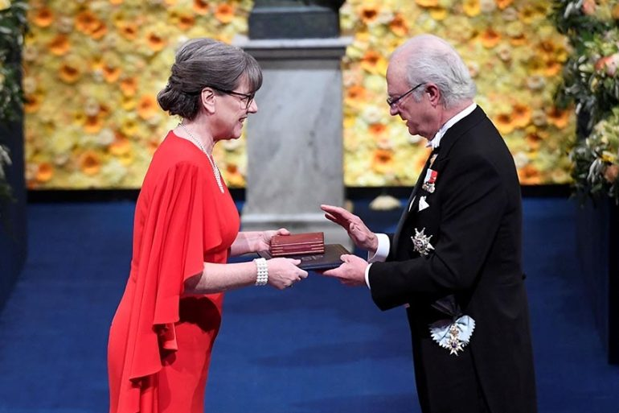

::: module-meta
⏱ ~15 minutesTrack: everyone working toward a publication (optional for BA)Checkpoint: [Module 7 quiz]()
:::

{.module-hero fig-alt="A scientist receiving an award at a formal prize ceremony"}

## Why this matters

Authorship is how credit and responsibility are shared in science. Clear rules, agreed early, prevent the most painful conflicts a research team can have.

## Authorship

- Authorship and preferred author position are discussed **in advance**.
- Authorship goes to lab members who make a **continuous creative contribution** to the project.
- All authors are involved in the writing process, and all authors must take an active part in it.
- Honorary and guest authorships are not allowed.
- We record contributions with the [tenzing app](https://rollercoaster.shinyapps.io/tenzing/), which uses the [CRediT taxonomy](https://credit.niso.org/). Start from a copy of the [contributors table template]().

## Choosing a journal

Before writing, we agree on a shortlist of target journals. Collect candidates in a copy of the [target journal template]() (journal, publisher, impact factor, SJR and WoS rankings). An AI agent can prefill the rankings for you; spot-check a few against the official sources.

## Citation engineering

Questionable practices to inflate citation counts are not acceptable:

- needless self-citations, or asking others to cite your work when it isn't relevant;
- citing friends or journals just to boost their counts;
- as a reviewer, asking authors to cite your own work without a proper reason.

## Responding to reviewers

- Be extremely polite and patient in your response.
- The first reading of a review can feel insulting. Take your time before you answer.
- Don't get defensive. Treat the review as feedback that helps you improve the work.
- Use this article as a guide: <https://psyarxiv.com/kyfus/>.
- Track every reviewer comment in a copy of the [revision tracker template](): one row per comment (E = editor, R1.01 = reviewer 1, comment 1), with the answer, the manuscript change, who is responsible, and whether it's approved. An AI agent can split the decision letter into rows and draft first answers for you to revise.

## Do

- [ ] Look up the 14 CRediT roles and note which ones you expect to have in your current project. Discuss them with your supervisor at your next meeting.

## Check yourself

::: quiz
A lab member helped recruit participants for two weeks but wasn't involved in designing, analyzing or writing the study. Should they be an author?

- [ ] Yes, everyone who helped should be an author.
- [x] Not by default. Authorship requires a continuous creative contribution, but their help should be acknowledged.
- [ ] Only if they ask for it.

::: explain
Authorship is for continuous creative contribution and active participation in writing. Other help belongs in the acknowledgments, and the CRediT roles make this explicit.
:::
:::

::: quiz
When should you and your co-authors agree on the author order?

- [ ] After the paper is accepted.
- [ ] When the first draft is ready.
- [x] In advance, at the start of the project, revisiting it if contributions change.

::: explain
Authorship and author position are discussed in advance. Early agreement prevents conflict later.
:::
:::

::: quiz
You're reviewing a paper and notice that your own study would be relevant but isn't cited. What's appropriate?

- [ ] Require the authors to cite your two most recent papers.
- [x] Suggest it only if it is genuinely relevant to their argument, the same way you would suggest anyone else's work.
- [ ] Reject the paper for incomplete literature review.

::: explain
Asking for citations to your own work without a proper reason is not ethical. A relevant suggestion is fine; a self-serving one is not.
:::
:::

## Checkpoint

Take the [Module 7 checkpoint quiz]().
